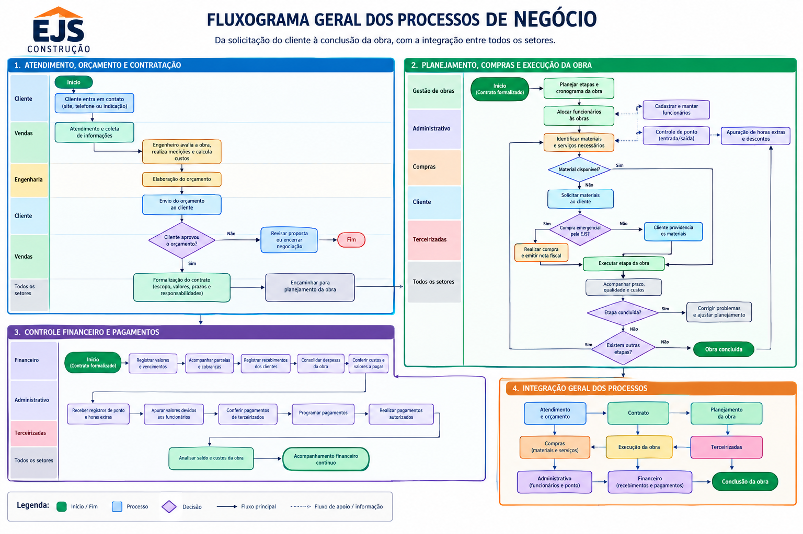
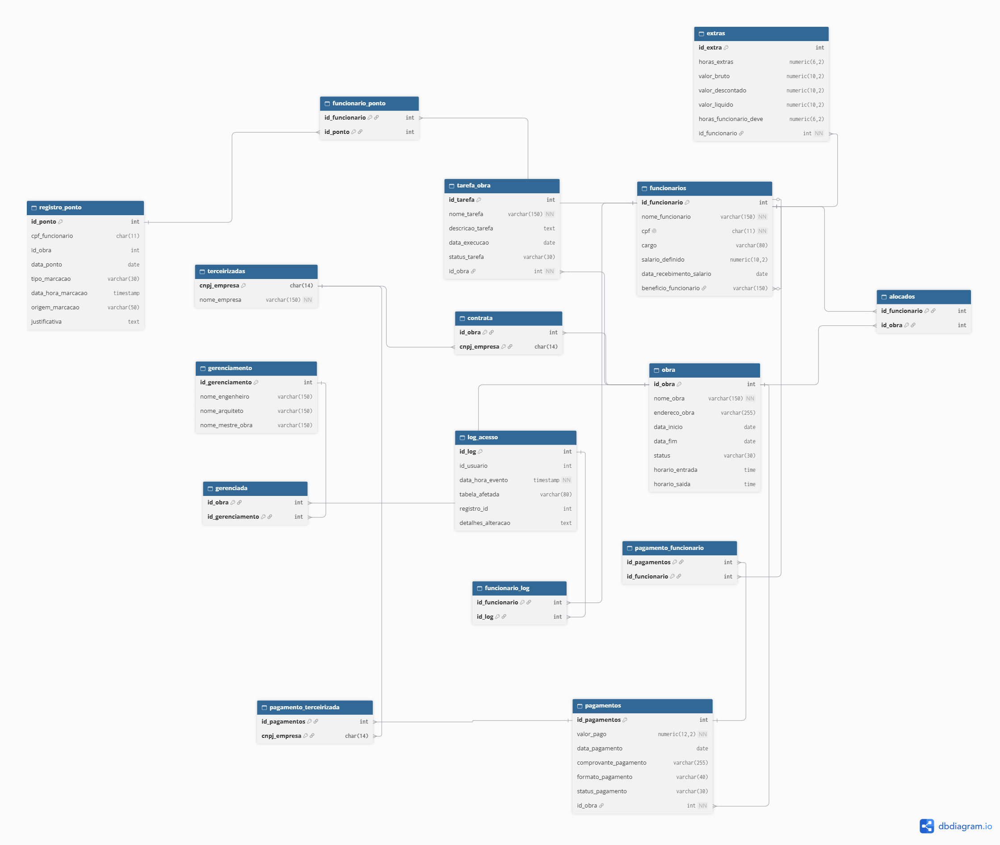

# Modelagem de Banco de Dados para Empreiteira EJS

Membros:

Maurício de Moura junior 
Rgm: 46898891

Thiago Pinho Macedo Araújo 
Rgm: 47016604

Anny Isabelly Silva Santos 
Rgm: 4729005-6

Cauã Victor da Silva Pena
Rgm: 04677095-0

---

## Introdução

Atualmente, a empresa apresenta um baixo número de obras em andamento e ainda possui limitações relacionadas à presença digital e à divulgação de seus serviços e obras realizadas. Além disso, a empresa enfrenta dificuldades no gerenciamento dos horários de entrada e saída dos funcionários, o que pode ocasionar divergências no controle das horas trabalhadas e, consequentemente, nos pagamentos realizados aos colaboradores.

Outro problema identificado está relacionado ao controle dos pagamentos realizados pela empresa. Quando os pagamentos não são devidamente registrados, torna-se difícil verificar posteriormente os valores pagos, as datas, os comprovantes, o formato utilizado e a situação de cada pagamento. Essa falta de controle pode ocasionar dificuldades na organização financeira e administrativa da empresa.

O objetivo do grupo é realizar a atualização e implementação de um site para a empresa, tornando-o ativo e utilizando-o como ferramenta de divulgação de seus serviços e obras realizadas. Dessa forma, busca-se criar uma presença digital para a empresa e, futuramente, possibilitar investimentos em marketing digital, ampliando seu alcance ao público da internet e contribuindo para a captação de novos clientes e obras.

Além da divulgação, o projeto terá como objetivo implementar funcionalidades de gerenciamento dos funcionários, controle de horas extras e horas devidas, registro de pagamentos, cadastro de empresas terceirizadas, gerenciamento das obras, responsáveis pelo gerenciamento das obras, tarefas e ícones utilizados pelo sistema.

Para o armazenamento e gerenciamento dessas informações, será desenvolvido um banco de dados estruturado a partir da entidade principal **EMPRESA**, da qual se relacionam as entidades **PAGAMENTOS**, **FUNCIONARIOS**, **TERCEIRIZADAS**, **OBRA** e **ICONE**. A entidade **FUNCIONARIOS** possui ainda a entidade dependente **EXTRAS**, enquanto **OBRA** possui as entidades **GERENCIAMENTO** e **TAREFA_OBRA**.

Dessa forma, o projeto estará concentrado na refatoração do site existente, na implementação das funcionalidades de gerenciamento e no desenvolvimento do banco de dados, não abrangendo, nesta etapa, outros sistemas ou funcionalidades que não estejam diretamente relacionados aos objetivos definidos.

---

## Desenvolvimento

O projeto teve início com a análise dos principais problemas encontrados na empresa e com a identificação de possíveis soluções. A partir dessa análise, foi elaborado um modelo inicial para representar a estrutura das informações e a forma como os dados poderiam ser armazenados.

Com a evolução do projeto, o modelo foi reorganizado para realizar uma arquitetura de como o banco de dados irá armazenar as informações cadastradas, durante o periodo do desenvolvimento nosso grupo sofreu alguns inpases, pois não compreendeu muito bem o modelo de projeto, até que o estrutor auxiliou nosso grupo com os detalhes do projeto e conseguimos compreender, o desenvolvimento desse projeto foi uma evolção e aprendizado dos erros que ocoreram na realização do processo.

O integrante Thiago que trabalha na empresa realizou uma entrevista com o dono, e mapeou as informações que deveria ser salvas em um banco de dados, pois o mesmo já estava desenvolvendo um site web para a instituição, e ficou mais facil de identificar alguns pontos, a foto da entrevista foi tirada na residencia do dono da empresa, pois a empresa não possui um endereço proprio e uma grande parte das reuniões são realizadas ou na residencia do dono, ou nas obras em execução, nessa entrevista foi feita algumas perguntas ao dono da empresa, como quais são os maiores problemas enfrentados, e foi feito uma apuração que atualmente o dono tem um grnade problema com relação a questão de coneguir 

### Caracterização da Organização

- **Nome e natureza da organização:** *ERENILDO JOSE DA SILVA CONSTRUCAO - ME / Prestação de serviços na construção civil, com foco em aplicação de revestimentos, resinas, pintura, limpezas após obras e reformas em geral.*
- **Contexto e porte:** Empresa com fins lucrativos atuando no setor de construção civil e empreitadas. A operação é de médio porte, contando com um volume constante de até 3 obras simultâneas. A equipe envolve cerca de 18 colaboradores no total, sendo composta por 1 engenheiro civil, responsável pela administração e criação de orçamentos, e 17 operários de campo, divididos entre mestres de obras, pedreiros e serventes. O volume mensal de atividades inclui a gestão de diversas tarefas por obra e o processamento de pagamentos e custos operacionais recorrentes.
- **Problemas e necessidades identificados:** A empresa enfrenta dificuldades no controle de assiduidade e pontualidade dos colaboradores, visto que atrasos frequentes podem ocorrer nos canteiros de obras sem o devido registro ou compensação das horas devidas. Também existem dificuldades no registro de pagamentos, horas extras, valores descontados e valores líquidos. Além disso, a organização possui necessidade de ampliar sua presença digital e melhorar a divulgação de seus serviços e obras realizadas.
- **Justificativa da escolha:** A escolha dessa empresa foi dada devido há um dos colaboradores o Thiago está trabalhando na empresa, e ter notado algumas icoerencias com relação ao gerenciamento de obras e funcionarios, o mesmo apresentou a empresa para o grupo e todos toparam aceitar o desafio de desenvolver um banco de dados para armazenar as informações, o dono da empresa atualmente no dia 07/10/2026 ainda anota pagamentos e horas trabalhadas tudo em cadernetas um problema gravisimo a ser resolvido.
- **Evidências da organização:** *CNPJ: 384180600001 / Site: https://empreiteira-ejs.vercel.app/index.html / Telefone: 11 98606-9654 / Instagram: https://www.instagram.com/ejs.empreiteira?igsh=MTdxcGNqZXpuNzcydQ%3D%3D&utm_source=qr*

---

### Processos de Negócio

| Processo | Grupo | Descritivo |
|---|---|---|
| Atendimento de clientes | Vendas | O processo inicia quando o cliente entra em contato com a EJS Construção por meio do site, telefone ou indicação. A empresa identifica as necessidades do cliente, coleta as informações iniciais e encaminha a solicitação para avaliação e elaboração do orçamento. |
| Elaboração de orçamento de obra | Vendas | O engenheiro analisa as características da obra, realiza ou avalia as medições necessárias, estima os custos de materiais, mão de obra e serviços terceirizados e define as condições de pagamento. O orçamento é apresentado ao cliente para aprovação. |
| Formalização do contrato | Vendas | Após a aprovação do orçamento pelo cliente, a empresa formaliza o contrato, registrando o escopo dos serviços, os valores acordados, as condições de pagamento, os prazos e as responsabilidades das partes. Com a formalização, a obra é encaminhada para planejamento e execução. |
| Execução e acompanhamento da obra | Gestão de obras | O engenheiro ou mestre de obras organiza as atividades, acompanha a execução dos serviços, verifica o cumprimento do planejamento e controla a qualidade do trabalho. Quando necessário, identifica atrasos, necessidades de materiais e ajustes operacionais. |
| Faturamento e recebimento de clientes | Financeiro | O setor financeiro acompanha os valores e vencimentos estabelecidos no contrato, registra as cobranças e os recebimentos e controla os recursos destinados às despesas operacionais e aos custos das obras. |
| Compra e fornecimento de materiais | Compras | A empresa identifica os materiais necessários para cada etapa da obra e informa as quantidades e especificações ao cliente, que normalmente realiza a compra. Quando surgem necessidades emergenciais, o financeiro, em conjunto com a gestão da obra, pode realizar a aquisição, encaminhando a respectiva nota fiscal ao cliente. |
| Contratação de empresas terceirizadas | Compras | A empresa identifica a necessidade de serviços especializados, solicita e compara propostas de prestadores terceirizados, avalia os valores e as condições oferecidas e seleciona o fornecedor mais adequado. Após a aprovação, são formalizadas as condições da contratação e a programação do serviço. |
| Pagamento de funcionários e terceirizados | Financeiro | O setor financeiro verifica os valores devidos, confere as informações necessárias e registra os pagamentos realizados aos funcionários e às empresas terceirizadas, mantendo os comprovantes e os registros financeiros correspondentes. |
| Cadastro e manutenção de funcionários | Administrativo | O setor administrativo registra e mantém atualizados os dados dos funcionários, incluindo informações pessoais, funcionais, contratuais e necessárias à gestão da equipe. |
| Controle de ponto dos funcionários | Administrativo | A empresa registra os horários de entrada e saída dos funcionários por meio do cartão de ponto ou de outro mecanismo adotado. Os registros são organizados por funcionário e data para apuração da jornada, das faltas e das horas extras. |
| Apuração de horas extras e descontos | Financeiro | Com base nos registros de ponto e nas informações de faltas e ausências, são apuradas as horas extras e os descontos aplicáveis, respeitando as regras trabalhistas e os critérios de remuneração adotados pela empresa. Os valores calculados são encaminhados para processamento da folha e pagamento. |
| Alocação de funcionários às obras | Gestão de obras | O responsável pela gestão de obras verifica as necessidades de cada projeto e distribui os funcionários conforme suas funções, qualificações, disponibilidade e cronograma, ajustando a equipe de acordo com o andamento dos serviços. |

---

### Requisitos do Sistema

#### Requisitos Funcionais

- **RF-01:** O sistema deve permitir o cadastro e a edição dos dados.
- **RF-02:** O sistema deve permitir o cadastro de funcionários, armazenando identificador, nome, CPF, cargo, salário definido, data de recebimento do salário e benefícios.
- **RF-03:** O sistema deve permitir o registro das informações adicionais dos funcionários na entidade **EXTRAS**, incluindo horas extras, valor bruto, valor descontado, valor líquido e horas que o funcionário deve.
- **RF-04:** O sistema deve permitir o registro e o gerenciamento dos pagamentos da empresa, armazenando valor pago, data, comprovante, formato de pagamento e status.
- **RF-05:** O sistema deve permitir o cadastro de empresas terceirizadas, armazenando identificador, nome da empresa, CNPJ e valor do serviço prestado.
- **RF-06:** O sistema deve permitir o cadastro de obras, registrando identificador, nome, endereço, período, status, descrição e horários de entrada e saída.
- **RF-07:** O sistema deve permitir o registro do gerenciamento de cada obra, contendo o nome do engenheiro, arquiteto e mestre de obra.
- **RF-08:** O sistema deve permitir a criação e o gerenciamento de tarefas vinculadas às obras, acompanhando nome, descrição, data de execução e status.
- **RF-09:** O sistema deve permitir o registro dos horários de entrada e saída dos funcionários, identificando o funcionário, a data, o horário registrado e a obra relacionada.
- **RF-11:** O sistema deve permitir o registro dos intervalos de trabalho, quando aplicável, para o cálculo correto da jornada diária.
- **RF-12:** O sistema deve calcular as horas trabalhadas com base nos registros de ponto e nas regras de jornada estabelecidas pela empresa.
- **RF-13:** O sistema deve identificar e registrar horas extras, atrasos e faltas com base na jornada prevista e nos registros realizados.
- **RF-14:** O sistema deve permitir consultar e emitir relatórios de ponto por funcionário, período e obra.

- 
#### Requisitos Não Funcionais

- **RNF-01 (Segurança):** O sistema deve garantir controle de acesso às informações administrativas e financeiras, principalmente às entidades **PAGAMENTOS**, **FUNCIONARIOS** e **EXTRAS**.
- **RNF-02 (Usabilidade/Portabilidade):** A interface do sistema deve ser responsiva e otimizada para dispositivos móveis, facilitando o uso por responsáveis e profissionais diretamente no canteiro de obras.
- **RNF-03 (Disponibilidade):** O sistema deve ser baseado em nuvem e possuir disponibilidade adequada para permitir acesso contínuo às informações da empresa e das obras.
- **RNF-04 (Desempenho):** Consultas comuns de funcionários, pagamentos, obras e tarefas devem apresentar tempo de resposta compatível com o uso operacional do sistema.

---

# Regras de Negócio 

## Regras Operacionais

- **RN-01 — Aprovação de orçamento:** Uma obra somente poderá avançar para a formalização do contrato após a aprovação do orçamento pelo cliente.
- **RN-02 — Formalização de contrato:** Antes do início da execução dos serviços, deverá existir um contrato formalizado com o cliente, contendo o escopo da obra, os valores acordados, os prazos e as condições de pagamento.
- **RN-03 — Responsabilidade pela obra:** Toda obra deverá possuir um responsável designado pela empresa, encarregado de acompanhar a execução dos serviços e verificar o cumprimento do planejamento.
- **RN-04 — Planejamento da obra:** A execução deverá seguir um planejamento com etapas, tarefas, prazos e recursos necessários, podendo ser atualizado conforme as necessidades identificadas durante a obra.
- **RN-05 — Alocação de funcionários:** Os funcionários deverão ser alocados às obras de acordo com suas funções, qualificações, disponibilidade e necessidades operacionais.
- **RN-06 — Controle de tarefas:** Toda tarefa deverá estar vinculada a uma obra e possuir um responsável ou encarregado pelo acompanhamento, além de informações sobre prazo e situação de execução.
- **RN-07 — Conclusão de tarefas:** Uma tarefa somente deverá ser considerada concluída após a realização do serviço e a verificação pelo responsável designado, conforme os critérios estabelecidos para a atividade.
- **RN-08 — Aquisição de materiais:** A empresa deverá identificar os materiais necessários para cada etapa da obra e informar ao cliente as quantidades e especificações previstas, considerando a responsabilidade de compra acordada entre as partes.
- **RN-09 — Compras emergenciais:** Quando houver necessidade de aquisição emergencial de materiais pela EJS Construção, a compra deverá ser registrada e acompanhada do respectivo comprovante fiscal, que será encaminhado ao cliente conforme o procedimento acordado.
- **RN-10 — Contratação de terceirizados:** A contratação de empresas terceirizadas deverá considerar a necessidade do serviço, a análise das propostas recebidas, os custos e as condições oferecidas, respeitando a aprovação interna e os termos acordados.
- **RN-11 — Controle de pagamentos:** Os pagamentos a funcionários e empresas terceirizadas deverão ser conferidos com base nos valores devidos, nos registros disponíveis e nas condições acordadas antes de sua realização.
- **RN-12 — Controle de recebimentos:** Os recebimentos dos clientes deverão seguir os valores, vencimentos e condições estabelecidos no contrato, mantendo os registros atualizados para acompanhamento financeiro de cada obra.

## Regras de Controle de Ponto e Remuneração

- **RN-13 — Registro de ponto:** Os horários de entrada e saída dos funcionários deverão ser registrados e associados ao funcionário e à data correspondente, permitindo a apuração da jornada de trabalho.
- **RN-14 — Apuração da jornada:** As horas trabalhadas deverão ser calculadas com base nos registros de ponto, considerando a jornada prevista, os intervalos aplicáveis e as regras trabalhistas pertinentes.
- **RN-15 — Horas extras e faltas:** As horas extras, faltas, atrasos e ausências deverão ser apurados a partir dos registros de jornada e das justificativas aplicáveis, respeitando a legislação trabalhista e os critérios de remuneração adotados pela empresa.
- **RN-16 — Cálculo de valores devidos:** Os valores de remuneração, adicionais e descontos deverão ser calculados conforme os registros disponíveis, as condições contratuais e as regras legais aplicáveis, evitando cobranças ou descontos duplicados.
- **RN-17 — Cadastro de funcionários:** Todo funcionário deverá possuir um cadastro individual com os dados obrigatórios necessários à identificação, à gestão administrativa e ao processamento de sua remuneração.
- **RN-18 — Identificação de funcionários:** Cada funcionário deverá possuir um CPF válido, utilizado para identificação individual e prevenção de cadastros duplicados.

## Regras Financeiras e de Terceirização

- **RN-19 — Identificação de empresas terceirizadas:** Cada empresa terceirizada deverá ser identificada por um CNPJ válido, evitando duplicidade de cadastro.
- **RN-20 — Controle financeiro por obra:** As receitas e despesas relacionadas a cada obra deverão ser registradas de maneira que permitam acompanhar os custos e avaliar a utilização dos recursos financeiros.
- **RN-21 — Padronização de status:** Os status de obras, tarefas e pagamentos deverão seguir opções padronizadas, permitindo acompanhar suas situações de forma consistente.
- **RN-22 — Integridade dos registros:** Os registros financeiros, administrativos e operacionais deverão manter informações consistentes e vinculadas às respectivas obras, funcionários, clientes ou empresas terceirizadas, conforme aplicável.
- **RN-23 — Cálculo do valor líquido:** O valor líquido devido ao funcionário deverá ser calculado considerando o valor bruto, os descontos e os adicionais aplicáveis, sem duplicidade de lançamentos. Quando todos os adicionais já estiverem incluídos no valor bruto, deverá ser aplicada a fórmula: valor líquido = valor bruto − descontos.
- **RN-24 — Comprovantes e responsáveis por pagamentos:** Todo pagamento realizado pela EJS Construção deverá possuir um responsável identificado, registro do valor, data, destinatário e comprovante correspondente. Quando o pagamento ocorrer por meio que não gere comprovante convencional, deverá existir um registro alternativo adequado para demonstrar a operação.
- **RN-25 — Pagamento de empresas terceirizadas:** O pagamento de serviços terceirizados deverá ocorrer após a conferência e aprovação da medição ou da conclusão da etapa contratada, conforme os critérios, prazos e condições definidos no contrato com a empresa prestadora.

## Regras de Aprovação e Execução de Obras

- **RN-26 — Autorização para início da obra:** Nenhuma obra deverá ser iniciada sem a aprovação do orçamento pelo cliente e a formalização do contrato, além das autorizações e condições prévias necessárias à execução do serviço.
- **RN-27 — Responsabilidade técnica da obra:** Cada obra deverá possuir o responsável técnico legalmente habilitado, com registro profissional válido e emissão da Anotação de Responsabilidade Técnica (ART), quando exigível, conforme as normas aplicáveis à atividade.
- **RN-28 — Segurança do trabalho:** A execução das obras deverá cumprir as normas de segurança e saúde no trabalho aplicáveis, incluindo a NR-18 quando pertinente, com adoção das medidas preventivas exigidas e fornecimento, orientação e utilização dos equipamentos de proteção individual (EPIs) adequados aos riscos da atividade.

## Regras de Proteção de Dados e Compras

- **RN-29 — Proteção de dados pessoais:** Os dados pessoais dos funcionários, incluindo CPF e informações salariais, deverão ser acessados somente por pessoas autorizadas e utilizados para finalidades legítimas relacionadas às atividades da empresa, com medidas de segurança e tratamento em conformidade com a Lei Geral de Proteção de Dados Pessoais (LGPD).
- **RN-30 — Aprovação de compras de materiais:** As compras de materiais realizadas pela empresa deverão ser previamente aprovadas pelo responsável autorizado, considerando a necessidade da obra, o orçamento disponível e os valores apresentados. Compras emergenciais deverão ser justificadas, registradas e submetidas à aprovação conforme o procedimento interno estabelecido.

## Regras Complementares de Ponto e Remuneração

- **RN-31 — Registro diário de ponto:** Os horários de entrada e saída deverão ser registrados diariamente para cada funcionário, associados à data e à obra em que o serviço foi realizado. Os intervalos de trabalho também deverão ser registrados quando necessários à apuração da jornada.
- **RN- 32 — Tratamento de atrasos:** Os atrasos deverão ser apurados com base na jornada prevista e nos registros de ponto, observando as tolerâncias estabelecidas pela legislação trabalhista aplicável e por eventuais instrumentos coletivos. A empresa deverá definir e documentar sua política de tratamento de atrasos.
- **RN-33 — Horas devidas:** As horas devidas deverão ser apuradas com base na jornada prevista e nos registros de ponto, considerando as justificativas e as ocorrências registradas. Eventuais descontos deverão respeitar a legislação trabalhista e as regras aplicáveis, sem gerar descontos automáticos indevidos.
- **RN-34 — Pagamento de horas extras:** As horas extras deverão ser calculadas com base na jornada registrada e na jornada contratual, aplicando o adicional mínimo previsto na legislação vigente ou percentual superior estabelecido em instrumento coletivo ou condição mais favorável aplicável.

#### Restrições Organizacionais

A modelagem deverá considerar que a empresa trabalha com funcionários próprios e empresas terceirizadas. Essas duas categorias são representadas separadamente para evitar a mistura de informações de pessoas físicas com informações de pessoas jurídicas.

Os dados financeiros diretamente relacionados a horas adicionais dos funcionários foram separados na entidade **EXTRAS**, enquanto a entidade **PAGAMENTOS** registra as operações de pagamento da empresa.

As informações específicas de uma obra foram distribuídas entre **OBRA**, **GERENCIAMENTO** e **TAREFA_OBRA**, permitindo separar os dados gerais da obra, seus responsáveis e suas atividades.

---
## **Dicionário de Dados**

Os dois dicionarios conceitual e em formato html estão em outros dois arquivos separados, para manter uma melhor organização do projeto.

- [dicionario.html](https://github.com/Thdeveloper2024/projeto-faculdade-modelagem-banco-de-dados/blob/main/dicionario-conceitual.md) — dicionário navegável, alinhado ao DER.
- [dicionario-conceitual.md](https://github.com/Thdeveloper2024/projeto-faculdade-modelagem-banco-de-dados/blob/main/dicionario.html) — dicionário conceitual.

---

### Diagrama Entidade-Relacionamento (DER)

O DER atualizado está representado abaixo:

[Visualizar diagrama no GitHub](https://github.com/Thdeveloper2024/projeto-faculdade-modelagem-banco-de-dados/blob/main/der.png)

1 - Alteração: Foi criada novas entidades que forám transformadas em tabelas, as novas entidades forám as seguintes (Extras, gerenciamento, registro de pontos e logs de acesso), pois foi notado que caso não tivesse a tabela extras, não iria conseguirmos saber quais foram as os horarios de entrada e saida, e sem isso não iriamos conseguir saber o valor de horas devidas e pendentes pelos funcionarios, depois foi criada a tabela de gerenciamento, pois precisamos armazenar os dados separadamente para não haver mistura de informações e para ter uma organização dos dados, foi criada a tabela de registro_pontos, para saber os dias que os funcionarios foram e os dias que faltarám, ela armazena dados inportantes para o controle de faltas, e uma tabela de logs_acesso, para o administrador principal conseguir fazer analises de seguranças e visualizar quem acessou cada coisa.

2 - Alteração: Definimo as cardinalidades com mais clareza, pois no modelo anterior a maioria estáva 1:1 e adicionamos os relacionamentos corretos entre as tabelas.

---

### Justificativa Técnica

O projeto teve início a partir da análise dos principais problemas identificados na empresa EJS Construção, com o objetivo de compreender suas necessidades operacionais e propor soluções tecnológicas que contribuíssem para a organização e o gerenciamento das informações. Durante o levantamento inicial, o proprietário relatou dificuldades no controle dos horários de entrada e saída dos funcionários, uma vez que os registros eram realizados manualmente em folhas de papel, que eventualmente eram perdidas, ocasionando dificuldades na consulta e no acompanhamento das informações. Diante dessa situação, identificou-se a necessidade de desenvolver uma solução informatizada que permitisse armazenar, organizar e consultar esses registros de maneira centralizada e segura.

A partir desse levantamento, foram identificados os principais requisitos para o desenvolvimento do sistema e da estrutura do banco de dados. Um dos integrantes do grupo, que também atua na empresa, contribuiu diretamente para essa etapa, realizando o levantamento das necessidades operacionais e apresentando os principais pontos que deveriam ser considerados durante o desenvolvimento da solução.

Com o avanço do projeto, a estrutura inicialmente proposta passou por reorganizações para estabelecer uma arquitetura adequada ao armazenamento e ao relacionamento das informações. Durante esse processo, o grupo enfrentou algumas dificuldades relacionadas à compreensão do modelo de projeto e à definição de sua estrutura. Entretanto, com o auxílio e as orientações do instrutor, foi possível esclarecer os pontos necessários, compreender melhor os requisitos e dar continuidade ao desenvolvimento. Dessa forma, o processo também proporcionou o aprimoramento dos conhecimentos técnicos dos integrantes, principalmente por meio da identificação e correção de inconsistências encontradas durante as etapas de elaboração.

Para atender às necessidades identificadas, foi estruturado um banco de dados composto pelas seguintes tabelas: **OBRA, FUNCIONARIOS, REGISTRO_PONTO, GERENCIAMENTO, TAREFA_OBRA, LOG_ACESSO, TERCERIZADAS, PAGAMENTOS e USUARIOS**. Essas estruturas foram planejadas para armazenar informações específicas e estabelecer relacionamentos entre os diferentes dados utilizados na administração da empresa.

A estrutura desenvolvida permitirá ao proprietário acompanhar as obras em execução, consultar informações sobre o andamento das atividades e verificar os registros de entrada e saída dos funcionários. Também permitirá o controle das horas extras e dos respectivos valores a serem pagos aos colaboradores. Além disso, os responsáveis pelo gerenciamento de cada obra poderão organizar e distribuir as tarefas entre os funcionários e as empresas terceirizadas, proporcionando maior clareza na execução das atividades e reduzindo possíveis falhas de comunicação e atrasos decorrentes da falta de organização.

Outra funcionalidade importante está relacionada ao gerenciamento financeiro. Para isso, foi estruturada a tabela PAGAMENTOS, destinada ao registro e acompanhamento das movimentações financeiras relacionadas aos funcionários, às empresas terceirizadas e aos recebimentos provenientes dos clientes. Essa organização possibilitará maior controle sobre os valores registrados e facilitará a consulta ao histórico financeiro.

Também foi desenvolvida a tabela LOG_ACESSO, responsável por armazenar os registros de acesso ao sistema, permitindo identificar quais usuários realizaram operações e consultar o histórico de utilização. Essa funcionalidade contribui para a segurança e a rastreabilidade das informações. O sistema também prevê diferentes níveis de permissão, administrados pelo usuário principal, que poderá cadastrar os responsáveis pelo gerenciamento das obras, criar usuários e definir suas respectivas limitações de acesso. Dessa maneira, será possível restringir a visualização e a manipulação de informações conforme a função desempenhada por cada usuário. Por exemplo, um funcionário do setor financeiro não precisará ter acesso irrestrito às informações pessoais e salariais dos demais colaboradores.

Durante o desenvolvimento, também foram realizadas alterações e aprimoramentos nos documentos técnicos que compõem o projeto. O diagrama do banco de dados foi revisado, deixando de apresentar somente as cardinalidades dos relacionamentos e passando a especificar também as chaves primárias (PK), as chaves estrangeiras (FK) e os respectivos tipos de dados. As regras de negócio foram reformuladas e ampliadas para representar com maior precisão as condições e restrições necessárias ao funcionamento da solução, uma vez que a versão inicial apresentava definições insuficientes.

Além disso, foram corrigidas as informações de contato e apresentação da empresa, após orientações do professor sobre a necessidade de utilizar uma imagem mais profissional. A documentação referente à utilização de inteligência artificial também foi complementada, recebendo informações mais específicas sobre sua aplicação no desenvolvimento do projeto. Por fim, o dicionário de dados, desenvolvido em HTML, passou por atualizações para contemplar os novos requisitos e as adequações solicitadas durante as avaliações.

### Justificativas técnicas das decisões 

---

A modelagem do banco de dados da EJS Construção foi desenvolvida com o objetivo de organizar, armazenar e controlar as informações relacionadas à administração das obras, aos funcionários, às terceirizadas, aos pagamentos e aos registros de acesso ao sistema.

As decisões técnicas foram tomadas considerando a necessidade de manter a integridade das informações, evitar duplicidade de registros, facilitar consultas e estabelecer relacionamentos entre as entidades. A seguir, são apresentadas as justificativas para a escolha das chaves primárias, chaves estrangeiras, restrições e decisões arquiteturais utilizadas no modelo.

### Justificativa das chaves primárias

---

As chaves primárias foram definidas para garantir que cada registro possua um identificador único dentro de sua respectiva tabela. Sempre que possível, foram utilizados campos numéricos com identificação automática, facilitando a inserção, localização e manutenção dos registros.

- **EXTRAS – `id_extra`:** foi escolhido como chave primária por ser um identificador exclusivo para cada registro de horas extras. Sua utilização permite localizar individualmente cada lançamento, independentemente do funcionário relacionado.

- **FUNCIONARIOS – `id_funcionario`:** foi definido como chave primária para identificar cada funcionário. O CPF também possui característica de identificação única, podendo ser utilizado para pesquisas e consultas, porém a utilização de um identificador próprio facilita a organização e a manutenção dos registros.

- **LOG_ACESSO – `id_log`:** foi escolhido como chave primária por identificar individualmente cada evento registrado no histórico de acessos. Dessa forma, diferentes registros de um mesmo usuário podem ser armazenados sem conflitos.

- **USUARIOS – `id_usuario`:** foi definido como chave primária para identificar cada usuário cadastrado no sistema. O campo `login_usuario` também possui característica de unicidade, podendo identificar o usuário durante o processo de autenticação, mas o ID foi escolhido como identificador principal da tabela.

- **REGISTRO_PONTO – `id_ponto`:** foi escolhido para identificar individualmente cada marcação de ponto realizada pelos funcionários, permitindo armazenar diversos registros para um mesmo funcionário e uma mesma obra.

- **PAGAMENTOS – `id_pagamentos`:** foi definido como identificador único de cada pagamento registrado, permitindo localizar e controlar individualmente as movimentações financeiras.

- **OBRA – `id_obra`:** foi escolhido para identificar cada obra cadastrada. Embora o nome da obra possa ser utilizado como referência em pesquisas, o identificador numérico oferece maior praticidade para estabelecer relacionamentos com outras tabelas.

- **GERENCIAMENTO – `id_obra`:** essa tabela não possui um identificador independente, pois utiliza o próprio identificador da obra como chave primária e estrangeira. Essa decisão permite relacionar os responsáveis pelo gerenciamento diretamente à obra correspondente, incluindo engenheiro, arquiteto e mestre de obra.

- **TERCEIRIZADAS – `cnpj_empresa`:** foi escolhido como identificador único da empresa terceirizada, pois o CNPJ permite distinguir cada empresa cadastrada.

- **TAREFA_OBRA – `id_tarefa`:** foi definido como chave primária para identificar individualmente cada tarefa cadastrada, possibilitando localizar e acompanhar sua execução dentro de uma obra.

- **CONTRATA – `id_obra` e `cnpj_empresa`:** foram utilizados conjuntamente como chave primária composta, pois essa tabela representa o relacionamento entre obras e empresas terceirizadas. A combinação dos dois campos identifica cada vínculo entre uma obra e uma empresa.

- **PAGAMENTO_TERCEIRIZADA – `id_pagamentos` e `cnpj_empresa`:** foram definidos como chave primária composta, permitindo relacionar um pagamento à empresa terceirizada correspondente.

### Justificativa das chaves estrangeiras e dos relacionamentos

---

As chaves estrangeiras foram utilizadas para estabelecer conexões entre as tabelas, garantindo que os registros relacionados mantenham referências válidas. Essa estrutura permite integrar as informações e evitar que sejam registrados relacionamentos com dados inexistentes.

Os principais relacionamentos definidos no modelo são:

- **EXTRAS:** possui a chave estrangeira `id_funcionario`, que estabelece a ligação com a tabela FUNCIONARIOS. Essa relação permite identificar a qual funcionário pertencem as horas extras, os valores brutos, os descontos e os valores líquidos registrados.

- **LOG_ACESSO:** possui a chave estrangeira `id_usuario`, responsável por relacionar os registros de acesso aos usuários cadastrados. Assim, é possível identificar qual usuário realizou determinado evento no sistema.

- **REGISTRO_PONTO:** possui as chaves estrangeiras `cpf_funcionario` e `id_obra`, relacionando cada marcação de ponto ao funcionário e à obra correspondentes. Essa estrutura permite acompanhar os horários de entrada e saída dos funcionários em cada obra.

- **PAGAMENTOS:** possui as chaves estrangeiras `id_obra` e `cpf_funcionario`, permitindo relacionar os pagamentos às obras e aos funcionários correspondentes.

- **OBRA:** possui a chave estrangeira `cpf_funcionario`, que estabelece o vínculo entre a obra e o funcionário responsável indicado no modelo.

- **GERENCIAMENTO:** utiliza `id_obra` como chave primária e estrangeira, relacionando os responsáveis pelo gerenciamento à obra correspondente. Essa estrutura permite registrar as informações do engenheiro, arquiteto e mestre de obra responsáveis.

- **TAREFA_OBRA:** possui a chave estrangeira `id_obra`, permitindo relacionar cada tarefa à obra na qual será executada. Dessa maneira, uma obra pode possuir várias tarefas cadastradas.

- **CONTRATA:** utiliza `id_obra` e `cnpj_empresa` como chaves estrangeiras, relacionando as obras às empresas terceirizadas contratadas. A tabela foi criada para representar esse relacionamento entre as duas entidades.

- **PAGAMENTO_TERCEIRIZADA:** possui `id_pagamentos` e `cnpj_empresa` como chaves estrangeiras, estabelecendo a ligação entre os pagamentos e as empresas terceirizadas que os recebem.

Esses relacionamentos permitem que as informações sejam consultadas de maneira integrada, reduzindo a necessidade de repetir dados e facilitando o controle administrativo e financeiro da empresa.

### Justificativa das restrições aplicadas

---

As restrições foram consideradas para preservar a consistência e a confiabilidade das informações armazenadas no banco de dados.

**Unicidade:** as chaves primárias garantem que cada registro tenha um identificador exclusivo. Além disso, campos como `cpf_funcionario`, `cnpj_empresa` e `login_usuario` devem possuir valores únicos, evitando cadastros duplicados de funcionários, terceirizadas e usuários.

**Obrigatoriedade:** os campos utilizados como chaves primárias não podem permanecer sem valor, pois são necessários para identificar cada registro. As chaves estrangeiras também devem respeitar as regras de preenchimento definidas para cada relacionamento, evitando referências inválidas.

**Integridade referencial:** as chaves estrangeiras garantem que os relacionamentos apontem para registros existentes nas tabelas de origem. Por exemplo, não deve existir um registro de ponto associado a um funcionário ou a uma obra que não estejam cadastrados.

**Valores numéricos e monetários:** os campos destinados ao armazenamento de salários, pagamentos, horas extras, descontos e valores líquidos utilizam tipos numéricos apropriados, permitindo armazenar valores decimais e realizar operações matemáticas.

**Valores não negativos:** os campos relacionados a valores financeiros e quantidades de horas devem respeitar a regra de não permitir valores negativos, evitando inconsistências nos registros financeiros e trabalhistas.

**Datas e horários:** foram utilizados tipos específicos para armazenar datas, horários e registros temporais. Essa escolha permite controlar datas de execução das obras, pagamentos e marcações de ponto, além de registrar os momentos em que os usuários acessam o sistema.

**Tipos e tamanhos dos campos:** os atributos receberam tipos de dados e tamanhos compatíveis com as informações armazenadas. Como exemplos, foram definidos campos `INT` para identificadores, `VARCHAR` para textos, `DATE` para datas, `TIME` para horários e `NUMERIC` para valores monetários e quantidades decimais.

### Justificativa das decisões arquiteturais

---

A arquitetura do banco de dados foi organizada por meio da separação das informações em tabelas específicas, de acordo com suas finalidades. Essa divisão facilita a administração dos dados, reduz a repetição de informações e permite que cada área da empresa tenha seus registros organizados.

A tabela FUNCIONARIOS concentra os dados cadastrais dos colaboradores, enquanto EXTRAS e REGISTRO_PONTO armazenam informações relacionadas à jornada de trabalho. Essa separação permite acompanhar os registros de ponto e controlar as horas extras sem misturar essas informações aos dados cadastrais dos funcionários.

A tabela OBRA funciona como uma das principais entidades do modelo, pois centraliza informações sobre as construções e estabelece relacionamentos com tarefas, funcionários, gerenciamento, pagamentos e empresas terceirizadas.

A tabela TAREFA_OBRA foi criada para permitir o acompanhamento individual das atividades realizadas em cada construção. Já GERENCIAMENTO concentra os dados dos responsáveis técnicos e administrativos relacionados à obra.

Para o controle financeiro, foi criada a tabela PAGAMENTOS, responsável por armazenar informações como valor, data, comprovante, formato e situação do pagamento. A tabela PAGAMENTO_TERCEIRIZADA complementa essa estrutura, permitindo relacionar os pagamentos às empresas terceirizadas.

A tabela CONTRATA foi utilizada para representar o relacionamento entre obras e empresas terceirizadas. Essa separação permite registrar os vínculos entre as duas entidades sem precisar repetir os dados cadastrais das empresas em cada obra.

A tabela USUARIOS foi separada das demais entidades para organizar os dados de autenticação e os níveis de acesso ao sistema. Essa decisão permite estabelecer diferentes permissões de utilização, de acordo com as responsabilidades de cada usuário. Por exemplo, usuários do setor financeiro não devem ter acesso indiscriminado a informações pessoais e sensíveis dos funcionários.

Por fim, a tabela LOG_ACESSO foi criada para armazenar o histórico de eventos realizados pelos usuários, permitindo identificar o responsável por cada registro de acesso e manter informações importantes para auditoria e segurança do sistema.

Dessa forma, as decisões arquiteturais adotadas buscam proporcionar uma estrutura organizada, segura e de fácil manutenção, atendendo às necessidades administrativas e operacionais da EJS Construção e permitindo futuras ampliações do sistema.

Como possibilidades de evolução, caso o proprietário tenha interesse em dar continuidade ao projeto, pretende-se implementar novas funcionalidades que ampliem a integração entre a empresa e seus clientes. Entre as melhorias planejadas está a criação de uma tabela específica para o cadastro de clientes, possibilitando que eles tenham acesso à plataforma para consultar seus contratos, acompanhar o andamento das obras e realizar pagamentos das parcelas correspondentes às etapas de execução.

Também está prevista a implementação de um ambiente de comunicação por meio de um chat integrado à plataforma, com a criação automática de um grupo específico para cada obra. Esse ambiente poderá reunir engenheiros, arquitetos, mestres de obras e clientes, permitindo o compartilhamento de informações e atualizações sobre as atividades realizadas. Com isso, pretende-se proporcionar maior transparência na comunicação e no acompanhamento dos serviços contratados.

Outra possibilidade de implementação futura consiste na integração de um sistema físico de identificação de funcionários por meio de cartões físicos ou virtuais com tecnologia de aproximação, permitindo o registro dos horários de entrada e saída diretamente por meio de um dispositivo de leitura. Essa implementação complementaria o controle digital de ponto, reduzindo a dependência de registros manuais.

Diante das necessidades identificadas e das soluções propostas, o desenvolvimento do projeto justifica-se pela necessidade de modernizar os processos administrativos e operacionais da EJS Construção, proporcionando maior organização, centralização, segurança e facilidade de acesso às informações. A estrutura do banco de dados representa uma base tecnológica para apoiar o gerenciamento das obras, o controle dos funcionários, o acompanhamento financeiro e a administração dos usuários, contribuindo para a melhoria dos processos internos e possibilitando futuras expansões do sistema.

---

### Uso de Inteligência Artificial

O grupo utilizou uma ferramenta de inteligência artificial como apoio na revisão e reorganização da documentação do projeto.

| Item | Registro |
|---|---|
| **Ferramenta e etapa** | ChatGPT — Revisão e ajustes feitos nos arquivos README.me; Reiplementação das novas alterações solicitadas pelo professor no dicionario de dados em html e criação das fotos ilustrativas do fluxo Grama e Diagrama. |
| **Motivação** | Auxiliar na revisão e atualização da documentação, mantendo a consistência entre o novo DER, o dicionário de dados e as regras de negócio do projeto. |
| **Prompt utilizado** | Olá, estou fazendo um projeto da faculdade, o arquuvo readme é esse, a empresa que vou trabalhar é a empresa "Empreiteira EJS", atua na região de são paulo atualmente, já atua a cerca de 6 anos na area, trabalhando com demolição, alvenaria, hidraulica, eletrica, forros de gesso e drywall e limpeza pós obra, na empresa contem engenheiro, mestres de obra, ajudante e pedreiros, além das equipes tercerizadas que presta os serviçõs que foi sitado, preciso de ajuda para me orientar a criar isso Problema, objetivos e delimitação Corrige os erros de portugues e ajuste se não tiver certo vou te enviar na orde da pergunta anterior: Atualmente a empresa segue com um nivel muito baixo de obras em andamento, e não possui redes sociais e nem sites ativos para divulgações, não está conseguindo gerenciar os horarios de entrada e saidas dos fucionarios, o que está encarretando em pagamentos aos funcionarios, por menos horas de trabalho, e a empresa também tem um gravisimo problema que é a questão de pagamentos aos colaboradores tercerizados, e os funcionarios, como os pagamentos são feitos pela mulher do dono da empresa, muitas as vezes não são anotados, para quem pagou x valor, o que está ocasionando em dificuldades na hora de saber se já pagou ou não para os colaboradores. A ideia do grupo é criar um site contendo um sistema de gerenciamento, e divulgações das obras para futuramente o dono da empresa investir em marktig digital, tornando assim o publico da internet, seu publico alvo, para conseguir aumentar o nivel de obras em desenvolvimento, e também queremos adicionar uma parte no sistema para realizar a administração do horario de entrada e saida dos funcionarios, e gerenciar os pagamentos feitos aos colaboradores. Nosso projeto irá realizar ajustes no site já existente para tornalo ativo, e adicionar as etapas para gerenciar os horarios e pagamentos, e iremos desenvolver um banco de dados para salvar todas essas informações, nosso projetos será baseados apenas nisso, uma refatoração do site e criação do banco de dados. |
| **Resposta recebida** | Não consegui obter todas as respostas e prompts recebidos e enviados para a IA, pois o histórico do chat apagou. Também foram consideradas as informações que ainda estavam disponíveis para análise.  |
| **Fontes consultadas e verificadas** |  O conteúdo foi confrontado com o DER e com as regras fornecidas pelo próprio grupo. Também foi verificada a compatibilidade entre as entidades e seus respectivos relacionamentos.  |
| **Trechos rejeitados ou corrigidos** |  Informações do modelo anterior que não faziam mais parte do novo DER foram removidas ou substituídas. Foram priorizadas as informações que correspondiam à versão mais atual do modelo.  |
| **Justificativa da escolha final** |  Foram mantidas apenas as estruturas compatíveis com o modelo atualizado e com as regras definidas para as entidades. A escolha também considerou a organização e a consistência dos relacionamentos entre as entidades.  |
| **Reflexão crítica** |  A IA foi utilizada como ferramenta de apoio. A validação final das regras de negócio, chaves primárias, cardinalidades e nomes dos atributos permanece responsabilidade do grupo. Dessa forma, o uso da IA não substitui a análise e a tomada de decisão dos integrantes.  |

---

| Item | Registro |
|---|---|
| **Ferramenta e etapa** | ChatGpt — Conferência do dicionário de dados em HTML com a lista de itens exigidos (definição das entidades e associativas, fluxo de dados, convenções, expressão formal e leitura por entidade, log de acesso, acesso por operação e LGPD, prefixos); organização das regras de acesso por perfil, dos fluxos de ponto, horas extras e pagamentos e das leituras formais dos relacionamentos; elaboração de planilhas de acompanhamento. |
| **Motivação** |Auxiliar na verificação do que faltava no dicionário de dados, mantendo a consistência entre as regras de negócio definidas pelo grupo, o DER e a documentação, e apontar inconsistências antes da geração da versão final do arquivo HTML. |
| **Prompt utilizado** | Me informe se tem tudo isso no meu dicionario em html: o que deve ter: Faltam: definição das entidades e associativas; fluxo de dados; convenções (SGBD, collation, notação formal, prefixos, versão); expressão formal e leitura por entidade; log de acesso; acesso por operação e LGPD. Não usa prefixos-padrão. | Parte de logs: Na parte de logs, devera ter um painel que vai exibir todos os logs feitos por quais credenciais foi feitos, e em qual lugar logo, já na parte de segurança, terá o login para pessoas da parte administrativa, que terá acesso a valor que os funcionarios recebem, data de pagamentos e nessa parte somente pessoas que tem autorização podera acessar, e ai terá parte do painel que apenas os liders vai poder acessar, que vai poder monitorar logs, vai conseguir ter total acesso no painel, e a parte dos funcionarios comuns que são prestdores de cerviços e empresas tercerizada, eles vão conseguir visualizar dias trabalhados, data de pagamentos, pagamentos feitos ou pendentes, gerenciar suas faltas, e os engenheiros, arquitetos e mestre de obra terá acesso a o painel porém vai ser uma parte especifica, que vai conseguir definir quem vai ser escalado nas obras, o que falta na obra, andamento da obra, problemas que tem para resolver orçamentos para fazer no caso dos engenheiros apenas | Outra coisa, só quem tem acesso a todos dados senciveis de todo mundo será o acesso do gerente master que é o que pode ver tudo, e a parte administrativa deverá poder visualizar apenas dados basicos, como nome completo, cpf, data de naceimento, ano de contratação do funcionario | Vou utilizar o mysql que vou rodar o teste no xampp, e os elementos são todos em letra mminuscula, quando é mais de uma palavra eu separo dessa forma exemplo: assim_que_divido | Funcionario bate ponto, ponto é registrado e o sistema confere o horario de entrada e saida de acordo com os horarios da obra especifica que o funcionario está alocado, se for menor que o horario estabelecido da obra, é registrado a hora que ficou faltando, e as horas de entrada e saida do funcionario, e ai vai para a parte de horas extras devidas dos funcionarios, se ele bater ponto depois do horario de saida da obra, ai sim conta como hora extra, porém para evitar falhas de segurança e vunerabilidades, o engenheiro ou mestre da obra sempre quando for ter hora extra na obra especifica, o responsavel deve registrar no sistema até que horas vai ser a hora extra para o funcionario bater ponto no horario final da hora extra, assim evita do funcionario bater depois e receber horas extras indevidas, só recebe se o gerente da obra ter autorizado que iria ter hora extra. | O engenheiro visita obra junto com o dono da empresa, e cria orçamento de acordo com o que irá ser executado, o mesmo entra em contato com empresas tercerizadas e confere valores de serviços, e monta o orçamento. | O setor administrativo e financeiro fica responsavel por gerenciar horarios de entrada e saida de funcionarios, e responsavel por realizar pagamentos aos funcionarios e empresas tercerizadas, e recebe pagamento de clientes. | Engenheiro e mestre de obras fica responsavel por definir tarefas que devera ser executadas em obras, seleciona funcionarios e empresas para prestação de serviço, e aloca a equipe para execução da obra, realiza o monitoramento e acompanha o decorrer da obra. |
| **Resposta recebida** | A IA organizou as definições do grupo em perfis de acesso (Gerente Master, Administrativo, engenheiros, arquitetos e mestres de obra, e colaboradores), em fluxos de dados (ponto e jornada, hora extra autorizada, orçamento, execução da obra e financeiro) e em leituras formais dos relacionamentos entre as entidades. Também foi gerada uma versão do HTML com as folhas de log de acesso, convenções, fluxo de dados e leitura formal, que foi conferida item por item. Nem todas as respostas ficaram registradas, pois parte do histórico foi perdida.  |
| **Fontes consultadas e verificadas** | O conteúdo foi confrontado com o DER, com o código HTML do dicionário e com as regras fornecidas pelo próprio grupo. Também foi verificada a compatibilidade entre os nomes das tabelas sugeridos pela IA (como registro_ponto, extras e tarefa_obra) e as entidades do modelo.  |
| **Trechos rejeitados ou corrigidos** |  Foram corrigidas as setas em código matemático que não renderizam em HTML, o perfil "Líderes" que não havia sido definido pelo grupo, a contradição do perfil Administrativo (lançar pagamentos sem ver valores) e o erro de digitação "Sem Acesso Directo". A sugestão de collation e a classificação de snake_case como notação formal foram tratadas como sugestões da IA, e não como decisões do grupo. Foi priorizada a regra mais recente de acesso, em que o Administrativo visualiza apenas dados básicos.  |
| **Justificativa da escolha final** |  Foram mantidas as estruturas compatíveis com as regras definidas pelo grupo: acesso por perfil seguindo o princípio do menor privilégio, MySQL em ambiente XAMPP, nomes em minúsculo separados por underline e a exigência de autorização prévia de hora extra pelo engenheiro ou mestre de obras. A escolha também considerou a consistência entre os relacionamentos e os fluxos de dados.  |
| **Reflexão crítica** |  A IA foi utilizada como ferramenta de apoio, e parte do conteúdo gerado continha inconsistências que precisaram ser identificadas e corrigidas. A validação final das regras de negócio, perfis de acesso, chaves primárias, cardinalidades e nomes dos atributos permanece responsabilidade do grupo. Dessa forma, o uso da IA não substitui a análise e a tomada de decisão dos integrantes.  |

---

## Conclusão

O desenvolvimento deste projeto permitiu ao grupo compreender de forma mais ampla as principais necessidades administrativas e operacionais da Empreiteira EJS, além de aplicar, em uma situação próxima da realidade, os conhecimentos relacionados à análise de requisitos, regras de negócio, modelagem de banco de dados e organização das informações.

Inicialmente, o grupo realizou um levantamento e um mapeamento dos principais problemas encontrados na empresa. Entre eles, foram identificadas dificuldades relacionadas ao controle dos funcionários, registro dos horários de entrada e saída, acompanhamento de horas extras e horas devidas, organização dos pagamentos, armazenamento de comprovantes, controle das empresas terceirizadas, gerenciamento das obras e acompanhamento das tarefas realizadas. Também foi identificada a necessidade de melhorar a presença digital da empresa e a divulgação de seus serviços e obras realizadas.

A partir desse levantamento, foram definidas entidades capazes de representar e organizar essas informações de maneira estruturada. O modelo passou a contemplar as entidades PAGAMENTOS, FUNCIONARIOS, EXTRAS, TERCEIRIZADAS, OBRA, GERENCIAMENTO, TAREFA_OBRA, REGISTRO_PONTO, LOG_ACESSO e USUARIOS. Também foram estruturados relacionamentos específicos para representar as contratações de empresas terceirizadas pelas obras e os pagamentos destinados a essas empresas. Essa divisão permitiu separar as responsabilidades de cada conjunto de informações e tornar o modelo mais claro, organizado e preparado para sua implementação.

O Diagrama Entidade-Relacionamento (DER) desenvolvido pelo grupo representa a estrutura proposta para o sistema e demonstra como as diferentes informações da empresa poderão se relacionar dentro do banco de dados. Com a definição das entidades, atributos, chaves primárias, chaves estrangeiras, cardinalidades e regras de negócio, foi estabelecida uma base para que os dados possam ser cadastrados, consultados, atualizados e administrados de forma mais eficiente e segura.

Além da modelagem do banco de dados, o projeto também possui como objetivo contribuir para a modernização da empresa. A proposta não se limita somente ao armazenamento das informações, mas também prevê o desenvolvimento de um sistema de gerenciamento administrativo, capaz de facilitar o acompanhamento das atividades da empresa e das obras. Paralelamente, está prevista a evolução do site da Empreiteira EJS, para que ele possa ser utilizado como uma ferramenta de apresentação e divulgação dos serviços e trabalhos realizados, fortalecendo a presença digital da empresa e possibilitando futuramente o desenvolvimento de estratégias de marketing para alcançar novos clientes.

Como próximos passos, será necessário consolidar a implementação da estrutura desenvolvida em um Sistema Gerenciador de Banco de Dados, verificando as chaves estrangeiras, as restrições e a integridade dos registros. Também deverão ser realizados testes de inserção, consulta, atualização e exclusão de informações, a fim de verificar o funcionamento dos relacionamentos e das regras definidas. Posteriormente, o banco de dados poderá ser integrado ao sistema administrativo e ao site da empresa, permitindo que as informações sejam utilizadas efetivamente nas atividades diárias da organização. Esses passos representam a evolução natural da estrutura criada pelo grupo.

Outro ponto importante durante o desenvolvimento foi o trabalho em equipe. O projeto foi realizado por um grupo composto por cinco integrantes, que participaram das etapas de levantamento dos problemas, discussão das possíveis soluções, definição das entidades e atributos, elaboração das regras de negócio, desenvolvimento do DER e organização da documentação. O trabalho colaborativo permitiu reunir diferentes ideias e conhecimentos, além de desenvolver competências relacionadas à comunicação, divisão de responsabilidades, resolução de problemas e tomada de decisões em conjunto.

Dessa forma, considera-se que o projeto atingiu seu objetivo nesta etapa ao apresentar uma proposta estruturada para solucionar parte das dificuldades encontradas na Empreiteira EJS. A modelagem desenvolvida estabelece uma base para a construção de um sistema mais completo, permitindo que informações que atualmente podem estar dispersas sejam centralizadas e administradas de maneira organizada.

Por fim, o projeto demonstra como a tecnologia, a modelagem de banco de dados e o desenvolvimento de sistemas podem ser utilizados para apoiar a organização e a evolução de uma empresa real. A continuidade do trabalho, com a consolidação do banco de dados, o desenvolvimento do sistema administrativo e o aprimoramento do site, poderá transformar o modelo desenvolvido pelo grupo em uma solução funcional, contribuindo para melhorar os processos internos da empresa, facilitar a tomada de decisões e ampliar a divulgação de seus serviços.

---

## Referências Bibliográficas

[Normas ABNT utilizadas para desenvolver a justificativa tecnica.](https://www.pucminas.br/biblioteca/DocumentoBiblioteca/ABNT-GUIA-COMPLETO-Elaborar-formatar-trabalho-cientifico.pdf)

---

